

 

  

 

Developer focused on **full-stack apps, AI-powered tools and cybersecurity**. I like building things end to end, from a FastAPI backend and database to a clean React frontend, and I enjoy the low-level side too: C++, Linux and microcontrollers.

<table>
<tr><td>⚙️ <b>Full-Stack</b></td><td>React frontends, FastAPI backends, Firebase and Supabase for auth and data</td></tr>
<tr><td>🧠 <b>AI</b></td><td>AI features in web apps, computer vision with Python, generative AI fundamentals</td></tr>
<tr><td>🔁 <b>Automation</b></td><td>Python background services, API integrations, real-time alerts</td></tr>
<tr><td>🛡️ <b>Cybersecurity</b></td><td>Network scanning, threat visualization, Kali Linux, BLE signal analysis</td></tr>
<tr><td>🖥️ <b>Systems</b></td><td>C/C++, Win32 API, Linux, ESP32</td></tr>
</table>

## Tech Stack

**Languages**

**Frameworks**

**Data & Tools**

## Projects

<table>
<tr>
<td width="50%" valign="top">

### 🧠 MindSpace
*Full-stack AI web app*

A web app with AI features, built with a React frontend and a FastAPI backend, using Supabase and Firebase for user accounts and storage.

`React` `FastAPI` `Supabase` `Firebase`

</td>
<td width="50%" valign="top">

### 🌐 Threat-Pulse
*Real-time attack map*

A live, simulated dashboard that visualizes cyberattacks around the world as they happen, built for learning and demos.

`JavaScript` `HTML` `CSS`

</td>
</tr>
<tr>
<td width="50%" valign="top">

### 📈 Crypto Price Notifier
*Automated price alerts*

A Python service that watches prices through the Binance API and sends an alert the moment something drops past a set threshold.

`Python` `Binance API`

[**→ Repository**](https://github.com/Ahany1440/Automated-Crypto-Stock-Price-Drop-Notifier)

</td>
<td width="50%" valign="top">

### 📷 Motion Detection
*Computer vision with a webcam*

Reads a live camera feed and sounds an alarm when it detects movement in the frame.

`Python` `Computer Vision`

[**→ Repository**](https://github.com/Ahany1440/python-camera-movement-detection)

</td>
</tr>
<tr>
<td width="50%" valign="top">

### 📡 ESP32 BLE Radar
*Bluetooth signal tracker*

Firmware for the ESP32 that picks up nearby Bluetooth Low Energy devices, shows them on a terminal dashboard and tracks one by signal strength.

`C++` `ESP32` `BLE`

[**→ Repository**](https://github.com/Ahany1440/ESP32-Cyber-Radar-Interactive-BLE-Proximity-Signal-Tracker)

</td>
<td width="50%" valign="top">

### 🔐 Cryptotool CLI
*Encoding toolkit for the terminal*

A menu-driven command-line tool for converting text between ROT13, Base64, hex and binary in one place.

`Shell` `Linux`

[**→ Repository**](https://github.com/Ahany1440/cryptotool-cli)

</td>
</tr>
</table>

More: [Port Scanner](https://github.com/Ahany1440/Python-Port-Scanner-Python) · [Directory Scanner](https://github.com/Ahany1440/Directory-Security-Scanner_cpp) · [Process Manager](https://github.com/Ahany1440/Process-manager-C-) · [3D Donut Renderer](https://github.com/Ahany1440/Donut-python-render) · [Linked List](https://github.com/Ahany1440/Singly-Linked-List-CPP) · [Graphs](https://github.com/Ahany1440/Graph-Representation-Implementation)

## GitHub Stats

  

## Certifications

| Certification | Issuer |
|:---|:---:|
| ⚡ What Is Generative AI? | LinkedIn Learning |
| 🤖 Introduction to AI | Google |
| 🔬 Scientific Computing with Python | freeCodeCamp |

 

