## ⚔️ Weapons

  

| Realm | Skills |
|---|---|
| 🛡️ **Security** | Cybersecurity, threat intelligence, network reconnaissance, indicators of compromise, BLE/RF analysis, cryptography basics |
| 💻 **Languages** | Python, C++, C, JavaScript, SQL |
| 🌐 **Web** | React, FastAPI, HTML, CSS |
| 🗄️ **Backend & data** | Firebase, Supabase, socket programming |
| 🧰 **Systems & tools** | Linux (Kali), virtual machines, Git/GitHub, Win32 API, ESP32 |
| 🧠 **Other** | Computer vision, 3D math, data structures and algorithms |

## 🏰 Campaigns

| Project | Skills used |
|---|---|
| **Cryptotool CLI** | Python · ROT13, Base64, Hex, Binary on Kali |
| **Threat-Pulse / Cyber-Attacks-Map** | HTML · JavaScript · real-time visualization |
| **ESP32 Cyber Radar & BLE Tracker** | ESP32 · BLE advertisement sniffing · proximity signals |
| **Directory Security Scanner** | C++ · Win32 API · hidden-executable detection |
| **Process Manager** | C++ · Win32 API · live process snapshots |
| **Network Port Scanner** | Python · sockets · TCP handshakes |
| **MindSpace** | React · FastAPI · Supabase/Firebase |
| **Crypto/Stock Price Notifier** | Python · Binance API · automation |
| **Camera Movement Detection** | Python · computer vision |
| **Exam Portal Architecture** | Python · system design |
| **Data Structures** | C++ · linked lists · graphs |
| **3D Donut Renderer** | Python · projection and matrix math |

## 📊 Battle Record

  
  

  

  

